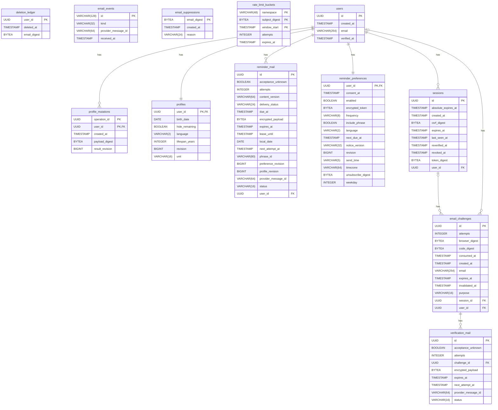

# Implemented database schema

Generated by `tools/export-database-diagram.py`; do not edit manually.

Source: fresh migrated PostgreSQL schema at `0006_account_lifecycle`. ERAlchemy `1.7.0`; SQLAlchemy `2.1.5`. Only schema metadata is reflected; planned entities are excluded.

See [data ownership and planned structures](database.md) and [regeneration/check instructions](../development/database-documentation.md). The diagram omits some index/check/default/policy details; migrations and tests remain authoritative. `alembic_version` is migration bookkeeping and is omitted.
