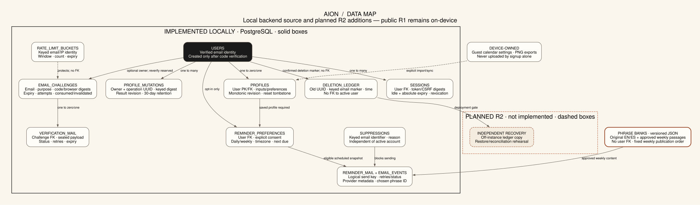
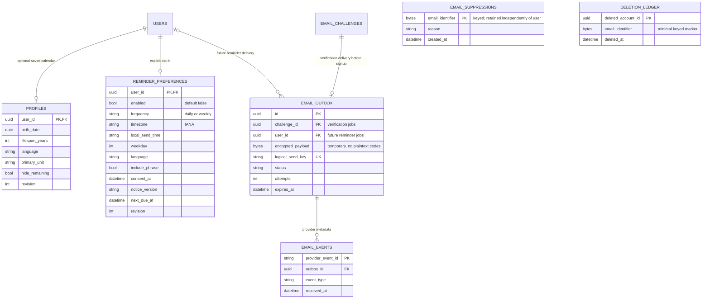
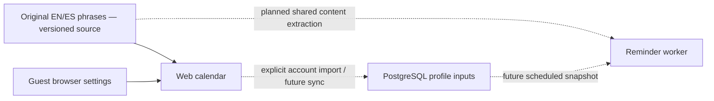

# Aion data model

Status: implementation map, not a claim of a deployed account service. The public R1 site still stores calendar settings only in each browser. The local backend foundation has four application tables under migration `0001_identity`; the signup/login slice adds `verification_mail` in `0002_verification`. Migration `0003_mail_result` adds provider acceptance ID/uncertainty metadata. `alembic_version` tracks schema revision separately. The accepted [R2 specification](../requirements/backend-release-specification.md) defines the planned additions.

The overview is generated from [Graphviz source](database.dot): `dot -Tsvg docs/architecture/database.dot -o docs/architecture/database.svg`. Solid boxes are implemented locally; dashed boxes remain planned. This authored overview includes plans; it is separate from the automatically generated implemented-schema diagram linked below.

## Implemented schema — generated automatically

See the [ERAlchemy-generated schema diagram](database-schema.md) and [canonical Graphviz source](database-schema.dot). They are reflected from a fresh schema built by Alembic migrations; backend checks fail if the committed text is stale. [Generate, render and inspect it locally](../development/database-documentation.md). Exact indexes, uniqueness and policy behavior remain in migrations/tests; `verification_mail.challenge_id` is unique, allowing at most one delivery record per challenge.

A first-login challenge has **no user foreign key**: an account is created only after successful verification. Reverification challenges belong to an existing user. Sessions/challenges referencing a deleted user cascade; this is a schema property, not an implemented account-deletion workflow. Rate counters deliberately do not require a user, so signup and nonexistent addresses receive the same abuse protection. The active challenge index permits only one unconsumed/non-invalidated challenge per email/purpose; resending invalidates its predecessor transactionally.

## Planned account sync and reminder data

These entities are **not implemented yet**. The planned general outbox may extend or replace the auth-specific `verification_mail` table; it is not a second currently deployed queue. Names below are logical design labels; subsequent reviewed migrations own exact fields/constraints.

Profiles contain the inputs/preferences, **not** a running counter or a row per lived week. Clients/backend derive totals using the same calendar contract. Reminder settings require a saved profile before activation; opt-in is distinct from verifying an email. Suppression/deletion markers are independent of live user records so account deletion and backup restoration cannot accidentally re-enable sending. The deletion ledger also needs an independently retained off-instance copy; another table on the same host is insufficient recovery evidence.

## Phrase bank and other data outside PostgreSQL

The original EN/ES phrase bank is currently the `phrases` array in `apps/web/src/i18n.ts`. It is source-controlled product content, with no per-user ownership and no database table. Before implementing reminders, move it to one versioned shared content file consumed by both web and Python. No phrase CRUD/admin service or database copy is required for R2. Delivery metadata may record the chosen phrase ID/content version without retaining complete private email bodies.

Guest settings and downloaded PNGs remain device-owned. Session credentials stay in HttpOnly cookies; only digests belong in PostgreSQL. Application encryption/HMAC keys belong in secret configuration, never in the same tables, source files, diagrams or logs. The server reads account settings to send reminders; this is not end-to-end encryption. See the [authentication contract](../api/authentication-contract.md) and [backend setup](../development/backend-setup.md) for implementation boundaries.
